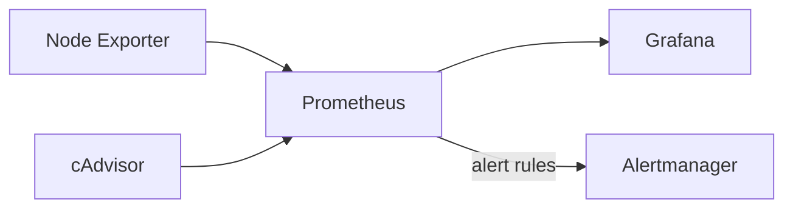

# prometheus-grafana-monitoring

**Goal:** Monitor a Linux server and its Docker containers with Prometheus and Grafana, with an alert rule that fires when a target goes down. Everything is deployed with Docker Compose.

## Tools used

- Prometheus (metrics collection and alert rules)
- Node Exporter (host metrics)
- cAdvisor (container metrics)
- Grafana (dashboards)
- Alertmanager (alert handling)
- Docker Compose
- AWS EC2 (Ubuntu)

## Architecture



## Project structure

```
.
├── docker-compose.yml
├── .env.example
├── prometheus/
│   ├── prometheus.yml          # scrape targets
│   └── alert.rules.yml         # alert rules
├── alertmanager/
│   └── alertmanager.yml
├── grafana/
│   └── provisioning/
│       └── datasources/
│           └── prometheus.yml  # auto-configures the data source
└── docs/                       # screenshots
```

## Setup

1. Launch an Ubuntu EC2 instance and install Docker:
   ```bash
   sudo apt update
   sudo apt install -y docker.io docker-compose-v2 git
   sudo usermod -aG docker $USER
   ```
2. In the security group, allow SSH (22), Grafana (3000) and Prometheus (9090) from your own IP only.
3. Clone the repo and set a Grafana password:
   ```bash
   git clone https://github.com/jashwanthreddy123/prometheus-grafana-monitoring.git
   cd prometheus-grafana-monitoring
   cp .env.example .env     # then edit GRAFANA_PASSWORD
   docker compose up -d
   ```
4. Open the tools:
   - Prometheus: `http://<EC2_PUBLIC_IP>:9090`
   - Grafana: `http://<EC2_PUBLIC_IP>:3000` (user `admin`, password from `.env`)
5. In Grafana, go to Dashboards → New → Import and load dashboard ID **1860** (Node Exporter Full).

## Alert rules

| Alert | Condition | Severity |
|---|---|---|
| InstanceDown | Any scrape target is down for 1 minute | critical |
| HighCPUUsage | CPU above 80% for 2 minutes | warning |

To test the alert:

```bash
docker compose stop node-exporter    # wait about 90 seconds, then check /alerts
docker compose start node-exporter
```

## Screenshots

### Prometheus targets


### Grafana dashboard


### Alert firing


## Notes

- Ports 3000 and 9090 are restricted to my IP in the security group.
- The Grafana password is stored in `.env`, which is not committed. Use `.env.example` as a template.
- Grafana only reads the admin password on first start. To change it later, run `docker compose exec grafana grafana cli admin reset-admin-password '<new-password>'`.
- Stop the EC2 instance when not in use to avoid charges.

## What I learned

- Configuring Prometheus scrape jobs and alert rules
- Provisioning Grafana data sources from files
- Collecting host and container metrics with Node Exporter and cAdvisor
- Keeping secrets out of Git with `.env` and `.gitignore`

